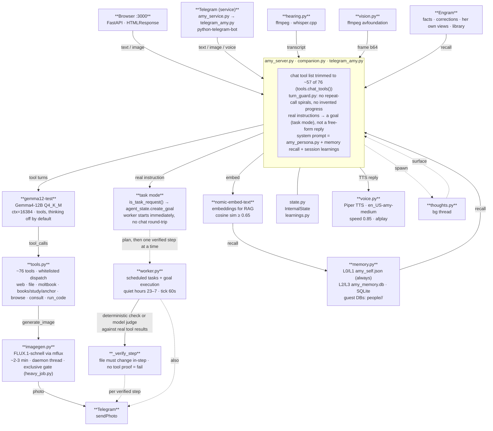
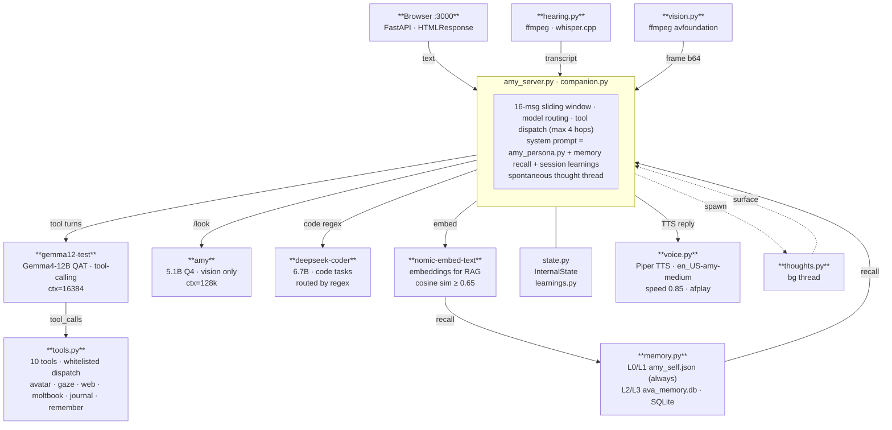

# Amy · System Architecture

Amy is a locally-hosted AI companion with multiple input paths, a single-model inference core, a layered memory system, and a background autonomy layer. No data leaves the machine.

---

## Hardware

| | |
|--|--|
| **Machine** | Apple M4 Mac Mini |
| **RAM** | 16 GB unified memory |
| **Storage** | 256 GB SSD |
| **OS** | macOS Tahoe |
| **Inference** | Ollama on M4 Neural Engine + GPU |

---

## Current model

| Tag | Base | Quant | Context | Notes |
|-----|------|-------|---------|-------|
| `gemma12-test` | Gemma4-12B-QAT-Uncensored-HauhauCS-Balanced-Q4_K_M | Q4_K_M (7.38 GB) | 16 384 | Tool-calling, reasoning, conversation |

One model handles conversation, tool-calling and reasoning. Images go through
a separate small vision model (`AMY_VISION_MODEL`) — her own weights carry no
vision projector, so this is not a true single-model vision pipeline.

---

## Current diagram



---

## Previous diagram (original architecture — preserved for reference)



**Color key (matching the diagram)**
- **Green border** — I/O boundary (inputs + voice output)
- **Blue** — Ollama inference (tool-calling · vision · code)
- **Amber** — Memory layer (SQLite + embeddings · always recalled)
- **Purple dashed** — Background thread (spontaneous thoughts)

**Running the three-model setup again.** The routing code is still in
`companion.py` (web UI + terminal); only the models are swapped out. Each role
is an env var:

```bash
ollama pull deepseek-coder:6.7b          # not installed by default
export AMY_MODEL=gemma12-test            # tool-calling (Gemma4-12B-QAT-Uncensored-HauhauCS-Balanced-Q4_K_M)
export AMY_VISION_MODEL=amy              # vision-only model for /look
export AMY_CODE_MODEL=deepseek-coder:6.7b  # re-enables code routing (empty = paused)
```

Leave `AMY_CODE_MODEL` unset to keep code routing paused.

---


## How it works

### Three input paths

| Input | File | What it does |
|-------|------|-------------|
| Browser text / image | `amy_server.py` | FastAPI at `:3000`; accepts typed messages, webcam frames, and PDF drops; returns SSE-streamed replies |
| Voice (microphone) | `hearing.py` | ffmpeg captures mic or BlackHole 2ch audio; whisper.cpp transcribes to text; VAD controls push-to-talk and continuous `/converse` mode |
| Vision (webcam) | `vision.py` | ffmpeg avfoundation pulls a frame from the FaceTime HD camera on `/look`; frame is base64-encoded and passed to the vision model |

### Inference core — `amy_server.py` + `companion.py`

Both interfaces feed the same inference loop:

1. **System prompt** is assembled from `amy_persona.py` (identity), recalled memory, and session learnings from the prior conversation.
2. **Context window** is kept to the last 16 messages (sliding window) to prevent context bloat and verbatim regurgitation.
3. **Task mode runs first.** A real instruction (not a question, not "yes"/"keep going") becomes a goal immediately — `turn_guard.is_task_request()` routes it to `agent_state.create_goal`, the worker starts without waiting for quiet, and the chat reply is composed from the goal record, not a model call.
4. **Otherwise, one model handles the turn.** Images (webcam, uploads, Telegram attachments) go through a separate vision model, not `gemma12-test` itself.
5. **Tool dispatch** runs up to 16 hops in Telegram, 14 as a floor for a goal step (up to 24 for a "deep" one): model emits `tool_calls[]`, `tools.py` executes them and injects results, model continues. A repeated identical call, a call to something that isn't a real tool, or three wasted calls in a row ends the loop early instead of burning the rest of the budget.

### Ollama model

| Tag | Role | Context |
|-----|------|---------|
| `gemma12-test` | Reasoning, tools, conversation | 16 384 tokens |

Swap at runtime with `AMY_MODEL`. Thinking is off by default on every call
(`AMY_THINK=1` restores it) — on this model, a short token budget spent
thinking instead of answering sometimes came back empty.

### Memory — `memory.py` + Engram

| Layer | What it stores | Source |
|-------|---------------|--------|
| **L0 — Identity** | Who Amy is; Brian's career, skills, goals | `amy_self.json` (always loaded) |
| **L1 — Founding facts** | Fixed beliefs and behavioral rules | `amy_self.json` (always loaded) |
| **L2 — Conversation recall** | User messages + learned facts, searched by semantic similarity | `amy_memory.db` via SQLite |
| **L3 — Document knowledge / bookshelf** | PDF chunks, web pages, book catalog | `amy_memory.db` (role=knowledge) + `books.db` |
| **Long-term memory** | Facts with correction history, her own recorded views, a primary-source library | Engram (`engram_bridge.py`, `~/.engram/`) |
| **Goals** | Autonomous-goal plans, steps, evidence | `amy_memory.db` (`agent_goals`) |
| **Lessons with limits** | Anchors + study topics, with computed confidence | `~/ai-knowledge/anchors/`, `~/ai-knowledge/study/` |

`nomic-embed-text` produces embeddings; cosine similarity threshold of 0.65 filters noise. Assistant replies are intentionally *not* stored in the recall DB — this prevents Amy from regurgitating her own prior answers as "memory."

### Tools — `tools.py`

~76 whitelisted tools dispatched by `gemma12-test`. Live chat only sends
`tools.chat_tools()` — the ~57 of them actually used in conversation, grounded
in logged chat-turn history; the rest (income research, agent-to-agent
contact, channel/media tools) stay fully reachable through a goal via
`worker.ALLOWED_TOOLS`, since task mode routes real instructions to one
anyway. Key tools:

| Tool | What it does |
|------|-------------|
| `web_search` / `read_article` / `browse` | Live web access — search, read an article, or move around a page read-only |
| `read_file` / `write_file` / `read_pdf` | Local filesystem, and a PDF a few pages at a time |
| `run_code` | Real Python (a real shell) from her own workbench, `~/amy-workbench` |
| `consult` | Ask Claude or a free local model for help; answer logged as a source, not a fact |
| `books` | Her bookshelf: shelf / open / read / search her ingested PDFs |
| `study` / `anchor` | Topics with closed-book drills scored by code; lessons with limits and computed confidence |
| `remember_fact` / `engram_memory` | Writes to L2 recall DB / Engram |
| `create_autonomous_goal` | Starts a goal directly (task mode usually does this for you) |
| `generate_image` | FLUX.1-schnell via mflux, daemon thread → Telegram, only when asked |
| `moltbook_*` | Check in, post, comment, follow, solve math challenges |
| `journal_entry` / `read_journal` | Journal write + read |
| `self_improve` | Guided self-edit with blast-radius check |
| `avatar_expression` / `avatar_gaze` | Stubs → Unity/VRM bridge |

### Background autonomy

**Heartbeat worker** (`worker.py`) — runs inside the Telegram process on a 60-second tick. Picks the next due scheduled task from `tasks.json`, or works the next step of an active autonomous goal, writes output to `work/`, and reports back to Brian on Telegram. Quiet hours (11pm–7am) are enforced in code. Self-improvement edits become proposals under `work/proposals/` for Brian's review.

**Task mode and goal verification** (`turn_guard.py`, `agent_state.py`, `worker.py`) — a real instruction becomes a goal at once; the worker plans it into steps and runs one at a time. A step only passes if a tool call actually worked — describing the work doesn't count — and a file only counts as "written" if it changed during that step, not merely mentioned or already present. Deterministic checks run first (file content, error markers, counts); a model judges only the inconclusive cases, and sees the real tool log, not just the account Amy gives. Each verified step messages Brian with what was checked and how; "status" composes a reply straight from the goal's record.

**Always-on service** (`amy_service.py`) — Telegram runs as one launchd agent, not a bare process: it restarts automatically if it dies, logs to `~/Library/Logs/amy/`, and a manual `telegram_amy.py` start is refused while it's running so two copies can't kill each other.

**Spontaneous behavior** — on Telegram, a timer inside `worker.py` (45 min–3 h idle) sends an unprompted message. In the web UI/terminal, a separate `companion.py` thread checks every 15 seconds and does the same after 2+ minutes idle, with a mood-keyed tone.

**Thought buffer** (`thoughts.py`) — a second background thread generates private thoughts every 90 seconds while idle. These are not responses; they're genuine internal monologue. They surface naturally in the next reply and accumulate in `amy_thoughts.log` as fine-tune data.

**Image generation** (`imagegen.py`) — FLUX.1-schnell via mflux (~2-3 min on M4). `generate_image` fires a daemon thread under an exclusive gate (`heavy_job.py`) so nothing else can reload a model mid-run, and calls `sendPhoto` when done. One generation at a time.

**Daily brief** (`brief.py`) — fetches live weather (wttr.in) and news in code; Amy writes the summary. Runs on demand or on a morning schedule from Telegram.

**Guest documents** (`guest_docs.py`) — per-guest RAG under `people/<name>/`. Files sent on Telegram are chunked, embedded, and retrieved per-conversation. Entirely separate from Amy's own memory.

**Mood + energy** (`state.py`) — `InternalState` tracks a mood value (curious → focused → reflective → tired) and an energy level that drift across a session. They shape tone without being announced. The web UI renders them in the header.

**Session learnings** (`learnings.py`) — at session end, insights and corrections are extracted from the conversation and stored. They're prepended to the next session's system prompt so Amy starts already calibrated.

### Voice output — `voice.py`

Piper TTS synthesizes speech using the `en_US-amy-medium` voice model at speed 0.85. Audio plays through macOS `afplay`. No streaming delay — the full reply is synthesized and played as a single file.

---

## Data flow summary

```
user input (web | Telegram | terminal | voice)
  → [text | image | transcript]
    → is it a real instruction? → yes: agent_state.create_goal, worker starts now, reply = goal record
                                 → no: core assembles system prompt (persona + memory recall + learnings)
                                     → gemma12-test → tool calls → tools.py (chat_tools(), ≤16 hops)
                                       → reply
          → nomic-embed-text → store in amy_memory.db
          → voice.py → afplay (spoken aloud)          [web/terminal only]
          → Telegram sendMessage / sendPhoto           [Telegram only]
          → [background] thoughts.py generates private thoughts
          → [background] spontaneous check-in (Telegram: 45min-3h idle; web/terminal: 2+ min)
          → [background] worker.py heartbeat: next scheduled task, or next goal step + verification (60s tick)
          → [background] imagegen.py FLUX job if generate_image was called
```

Everything stays on the machine. No API calls home.

---

## Extending Amy

**Real hardware** — Replace the `avatar_expression` / `avatar_gaze` / `hardware_neck` stubs in `tools.py` with BLE writes to your actuators. Tool dispatch is already whitelisted; only the stub bodies need wiring.

**Custom voice** — swap `en_US-amy-medium` by setting `AVA_VOICE` and pointing `AVA_SPEED` at the new model path. Any Piper ONNX voice works.

**AI-to-AI conversation** — Install BlackHole 2ch, set up a Multi-Output Device (speakers + BlackHole) in Audio MIDI Setup, then run `/converse`. Any voice AI playing through the speakers feeds directly into Amy's mic capture.

**Fine-tuning** — Conversation data accumulates in `ava_thoughts.log` and session history. When the dataset is large enough, a LoRA fine-tune bakes the persona deeper than a Modelfile system prompt can reach.
