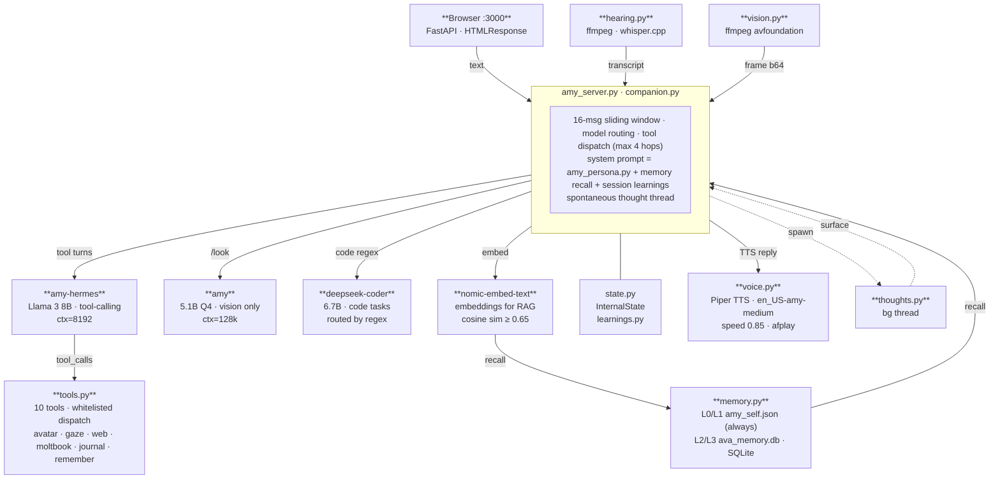

# Amy · System Architecture

Amy is a locally-hosted AI companion with three input paths, a multi-model inference core, a layered memory system, and a background autonomy layer. No data leaves the machine.

---

## Diagram



**Color key (matching the diagram)**
- **Green border** — I/O boundary (inputs + voice output)
- **Blue** — Ollama inference (tool-calling · vision · code)
- **Amber** — Memory layer (SQLite + embeddings · always recalled)
- **Purple dashed** — Background thread (spontaneous thoughts)

---
OR 


## How it works

### Three input paths

| Input | File | What it does |
|-------|------|-------------|
| Browser text / image | `amy_server.py` | FastAPI at `:3000`; accepts typed messages, webcam frames, and PDF drops; returns SSE-streamed replies |
| Voice (microphone) | `hearing.py` | ffmpeg captures mic or BlackHole 2ch audio; whisper.cpp transcribes to text; VAD controls push-to-talk and continuous `/converse` mode |
| Vision (webcam) | `vision.py` | ffmpeg avfoundation pulls a frame from the FaceTime HD camera on `/look`; frame is base64-encoded and passed to the vision model |

### Inference core — `amy_server.py` + `companion.py`

Both interfaces feed the same inference loop:

1. **System prompt** is assembled from `amy_persona.py` (identity), recalled memory, and session learnings from the prior conversation.
2. **Context window** is kept to the last 16 messages (sliding window) to prevent context bloat and verbatim regurgitation.
3. **Model routing** happens before the call:
   - Requests matching a code regex → `deepseek-coder:6.7b` (bypasses the tool loop entirely; clean code output only)
   - `/look` or image input → `amy` vision model first for a literal description, then that description is injected back into the main model's context (two-step pipeline avoids small-model RLHF refusals)
   - Everything else → `amy-hermes` (Llama 3 8B, tool-calling)
4. **Tool dispatch** runs up to 4 hops: model emits `tool_calls[]`, `tools.py` executes them and injects results, model continues. The loop stops at 4 hops or when no more tool calls are emitted.

### Three Ollama models

| Tag | Role | Context |
|-----|------|---------|
| `amy-hermes` | Reasoning, tools, conversation | 8192 tokens |
| `amy` | Vision description (webcam, uploads) | 128k tokens |
| `deepseek-coder:6.7b` | Code generation and debugging | — |

All three run locally via Ollama. Any model can be swapped at runtime with environment variables (`AMY_MODEL`, `AMY_VISION_MODEL`, `AMY_CODE_MODEL`).

### Memory — `memory.py`

Four layers, all local:

| Layer | What it stores | Source |
|-------|---------------|--------|
| **L0 — Identity** | Who Amy is; Brian's career, skills, goals | `amy_self.json` (always loaded) |
| **L1 — Founding facts** | Fixed beliefs and behavioral rules | `amy_self.json` (always loaded) |
| **L2 — Conversation recall** | User messages + learned facts, searched by semantic similarity | `ava_memory.db` via SQLite |
| **L3 — Document knowledge** | PDF chunks, web pages, book catalog | `ava_memory.db` (role=knowledge) + `books.db` |

`nomic-embed-text` produces embeddings; cosine similarity threshold of 0.65 filters noise. Assistant replies are intentionally *not* stored in the recall DB — this prevents Amy from regurgitating her own prior answers as "memory."

### Tools — `tools.py`

Ten whitelisted tools dispatched by `amy-hermes`:

| Tool | What it does |
|------|-------------|
| `web_search` | DuckDuckGo (no API key) |
| `read_article` | BeautifulSoup page reader |
| `remember_fact` | Writes to L2 recall DB |
| `moltbook_check_in` | Posts to her Moltbook feed |
| `moltbook_post` | Publishes a new post |
| `moltbook_engage` | Comments / follows |
| `moltbook_verify` | Solves math verification challenges programmatically |
| `journal` | Writes a journal entry |
| `avatar_expression` | Stub → Unity/VRM bridge |
| `avatar_gaze` | Stub → Unity/VRM bridge |

### Background autonomy

**Spontaneous behavior** (`companion.py` thread) — checks every 15 seconds; if Amy has been idle 2+ minutes she generates a mood-keyed check-in and speaks it unprompted. She does not wait to be addressed.

**Thought buffer** (`thoughts.py`) — a second background thread generates private thoughts every 90 seconds while idle. These are not responses; they're genuine internal monologue. They surface naturally in the next reply and accumulate in `ava_thoughts.log` as fine-tune data.

**Mood + energy** (`state.py`) — `InternalState` tracks a mood value (curious → focused → reflective → tired) and an energy level that drift across a session. They shape tone without being announced. The web UI renders them in the header.

**Session learnings** (`learnings.py`) — at session end, insights and corrections are extracted from the conversation and stored. They're prepended to the next session's system prompt so Amy starts already calibrated.

### Voice output — `voice.py`

Piper TTS synthesizes speech using the `en_US-amy-medium` voice model at speed 0.85. Audio plays through macOS `afplay`. No streaming delay — the full reply is synthesized and played as a single file.

---

## Data flow summary

```
user input
  → [text | transcript | frame b64]
    → core assembles system prompt (persona + memory recall + learnings)
      → route: code? → deepseek-coder
               image? → amy vision → description → hermes
               else  → amy-hermes → tool calls → tools.py (≤4 hops)
        → reply
          → nomic-embed-text → store in ava_memory.db
          → voice.py → afplay (spoken aloud)
          → [background] thoughts.py generates private thoughts
          → [background] spontaneous check-in if idle > 2 min
```

Everything stays on the machine. No API calls home.

---

## Extending Amy

**Real hardware** — Replace the `avatar_expression` / `avatar_gaze` / `hardware_neck` stubs in `tools.py` with BLE writes to your actuators. Tool dispatch is already whitelisted; only the stub bodies need wiring.

**Custom voice** — swap `en_US-amy-medium` by setting `AVA_VOICE` and pointing `AVA_SPEED` at the new model path. Any Piper ONNX voice works.

**AI-to-AI conversation** — Install BlackHole 2ch, set up a Multi-Output Device (speakers + BlackHole) in Audio MIDI Setup, then run `/converse`. Any voice AI playing through the speakers feeds directly into Amy's mic capture.

**Fine-tuning** — Conversation data accumulates in `ava_thoughts.log` and session history. When the dataset is large enough, a LoRA fine-tune bakes the persona deeper than a Modelfile system prompt can reach.
